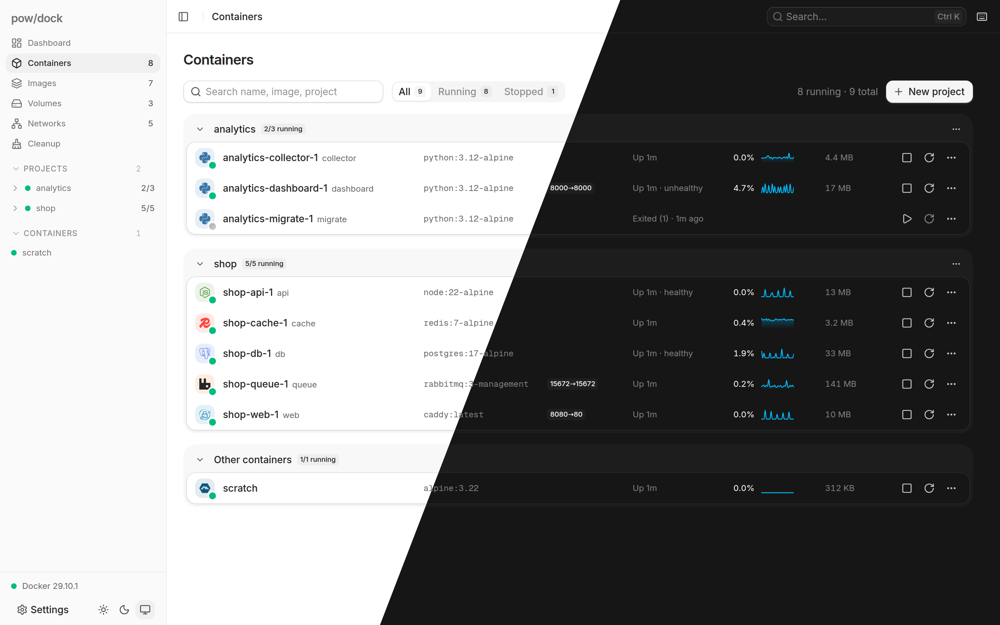

# pow/dock

pow/dock is a fast, light web UI for the Docker Engine on your machine. It is made to replace the heavy Docker Desktop window. Open it in your browser to see your containers, images, volumes and networks, and to clean up what you no longer need. It talks to the Docker Engine directly through its socket and uses about 30 MB of memory.



## Quick start

**With npx** (needs [Node.js](https://nodejs.org) 18 or newer):

```bash
npx powdock
```

pow/dock opens at http://127.0.0.1:3434. It runs on Bun. If Bun is missing, `powdock` asks before it installs Bun, and that copy goes only into `~/.powdock/runtime`. Flags, data folders, and updates are in [Install and update](docs/install.md).

On Windows, run it inside WSL 2. See [Windows](docs/install.md#windows).

**With Docker** (needs [Docker](https://docs.docker.com/get-docker/)):

```bash
docker run -d --name powdock --restart unless-stopped \
  -p 127.0.0.1:3434:3434 \
  -v /var/run/docker.sock:/var/run/docker.sock \
  --group-add "$(stat -c %g /var/run/docker.sock)" \
  -v powdock-data:/data \
  ghcr.io/powroom/powdock:latest
```

pow/dock runs as user 1000, so `--group-add` gives it access to the Docker socket. pow/dock knows the container it runs in and refuses to stop or remove it, so it cannot cut itself off.

**With Docker Compose:**

```bash
curl -o compose.yml https://raw.githubusercontent.com/powroom/powdock/main/compose.example.yml
echo "DOCKER_GID=$(stat -c %g /var/run/docker.sock)" > .env
docker compose up -d
```

The `.env` line saves `DOCKER_GID`, the group of the Docker socket, so that pow/dock can use the socket. With either Docker command, open http://localhost:3434 in your browser.

**From source:** see [Development](docs/development.md).

## First login

The first time you open pow/dock, create an admin account. Enter a username and a password of at least 8 characters. You sign in with it after that. To change the password later, go to Settings, then Account.

To create the admin when pow/dock starts instead, set `POWDOCK_ADMIN_PASSWORD` (and optionally `POWDOCK_ADMIN_USER`). See [Admin account and sign-in](docs/configuration.md#admin-account-and-sign-in).

## What you can do

**Containers and projects**

- The dashboard shows what needs attention (unhealthy, restarting, stopped with an error, near its memory limit), the counts of containers, images, volumes and disk use, and the CPU and memory in use now.
- Containers are grouped by Compose project, with live CPU and memory. Start, stop, restart, pause, kill and remove them one by one, or a whole project at once. Published ports open in a new tab.
- A Compose project has its own page: up, restart, pull and update, stop or take down, with the live output. See its merged logs, and edit its Compose file with a check before each save. New projects start from an empty file or from a `docker run` command.

**Container details**

- Live logs with colors, search, timestamps, pause and download. When the tab is hidden for 15 seconds, the logs stop, and they reconnect when you come back.
- The ports, environment (secrets hidden), mounts, networks and health of the container.
- A terminal: a shell in a running container, in the browser, with the container's default user. The Shell menu lists only the shells the container has (bash, zsh, fish, then sh). See [Terminal](docs/configuration.md#terminal).

**Images and updates**

- The list shows how many containers use each image. Pull an image with live progress, and remove a tag.
- Each image has its own page with its settings, the layer history, and a scan for known vulnerabilities with Trivy. See [Vulnerability scans](docs/configuration.md#vulnerability-scans).
- pow/dock checks the registry once every six hours (or when you ask) and shows an Update badge when a newer image exists. Update a container or a Compose service in one click.

**Volumes, networks, and cleanup**

- Volumes with their sizes and the containers that use them, networks with their subnets and attached containers. Details open in a side panel. Create and remove both.
- Cleanup shows how much disk Docker uses and what can be freed, by category: build cache, dangling or unused images, stopped containers, unused volumes and unused networks. Every step shows what goes before it runs.

**Other**

- Command palette (Ctrl/⌘+K) to jump to any page or container, open settings, or change the theme. The sidebar lists your projects and their containers.
- pow/dock tells you when a new version of itself is out.
- Dark mode, and a layout that works on a phone.

## Key shortcuts

| Shortcut     | What it does                                |
| ------------ | ------------------------------------------- |
| `Ctrl/⌘ + K` | Open or close the command palette           |
| `Ctrl/⌘ + B` | Show or hide the sidebar                    |
| `?`          | Show the keyboard shortcuts                 |
| `/`          | Move focus to the search box on a list page |

The full list is in [docs/shortcut.md](docs/shortcut.md).

## Security

- **Local only by default.** pow/dock listens on `127.0.0.1`, so only this computer can reach it. For other machines, put it behind a reverse proxy that uses HTTPS. See [Network security](docs/configuration.md#network-security-and-proxy).
- **Full control of Docker.** Access to the Docker socket is as powerful as root on this machine. A container can mount any folder of the host. For that reason pow/dock always asks for a login, and the login cannot be turned off.
- **Login limits.** Too many failed sign-ins from one address block it for a while.
- **Report a vulnerability** privately, as described in [SECURITY.md](SECURITY.md).

## Documentation

- [Install and update](docs/install.md): npx and Docker, Docker Compose, the data folders, and updates.
- [Configuration](docs/configuration.md): environment variables, the admin login, the terminal, network security, the update check, and vulnerability scans.
- [Shortcuts](docs/shortcut.md): every keyboard shortcut.
- [Development](docs/development.md): running from source, the checks, and the build.

## License

pow/dock is open source under the [Apache License 2.0](LICENSE). You can use, change, and share it, also in commercial products, as long as you keep the copyright and license notices (see [NOTICE](NOTICE)). The license does not give permission to use the pow/dock name or logo for your own product.
